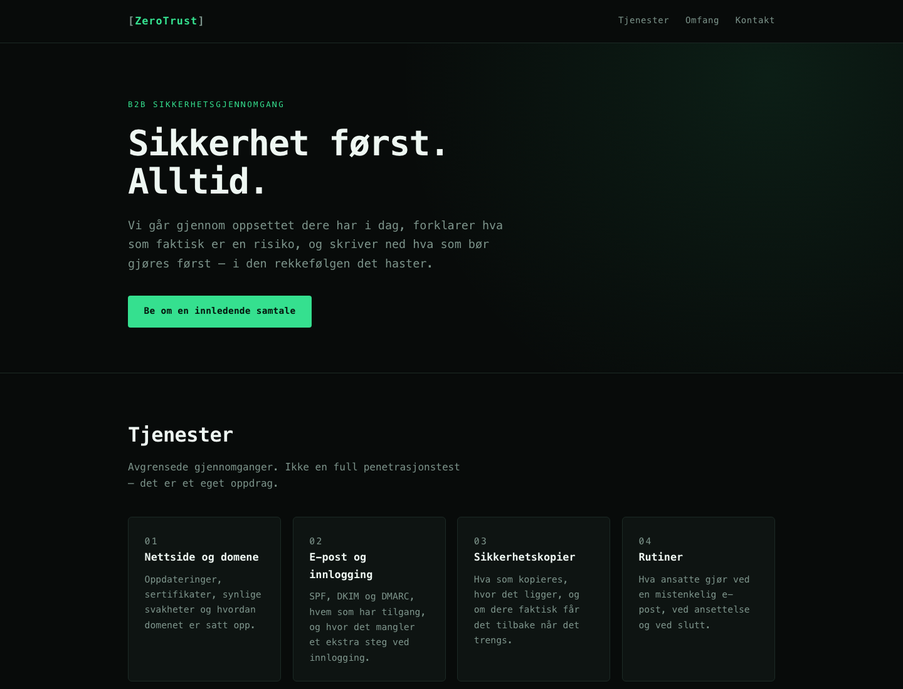

# ZeroTrust – landingssidekonsept for sikkerhetstjenester

Et mørkt, teknisk landingssidekonsept for en tenkt B2B-leverandør av avgrensede sikkerhetsgjennomganger.

> **Viktig:** Dette er et designkonsept, ikke en virksomhet. Siden selger ingenting, skanner ingenting og sender ingen skjemaer. Navnet er brukt som fiktivt merkenavn i et designprosjekt og har ingen tilknytning til en eksisterende virksomhet eller til noe kundeoppdrag.



## Hva den viser

- Fast header med terminalestetikk i monospace
- Hero med dempet radialgradient og tydelig verdiløfte
- Fire tjenestekort: nettside, e-post, sikkerhetskopier, rutiner
- To-kolonne «Dere får / Dere får ikke» – bevisst ærlig om hva en gjennomgang ikke er
- Kontaktseksjon og footer

Siden er bygget rundt et prinsipp: en sikkerhetsleverandør som lover for mye er ikke troverdig. Derfor står det eksplisitt at tjenesten **ikke** er en full penetrasjonstest og **ikke** gir garanti mot innbrudd.

## Teknisk

| | |
|---|---|
| Språk | HTML5, CSS3, JavaScript (ES2020) |
| Rammeverk | Ingen |
| Avhengigheter | Ingen |
| Tema | Mørkt (`color-scheme: dark`) |

## Kom i gang

```sh
python3 -m http.server --bind 127.0.0.1 8080
```

Åpne <http://127.0.0.1:8080>.

## Tilgjengelighet

- Kontrastforhold over WCAG AA mot den mørke bakgrunnen
- Semantiske landemerker, `lang="nb"` og «hopp til innhold»
- Fokusmarkering er tydelig også på mørk bakgrunn
- Animasjoner er begrenset til fargeoverganger og respekterer `prefers-reduced-motion`

## Begrensninger

- Ingen skjema, fordi det ville krevd en backend.
- Kontaktfelt er plassholdere.
- Ingen automatiserte tester eller revisjon med skjermleser. Siden er kontrollert manuelt i nettleser.

## Lisens

MIT – se [LICENSE](LICENSE).
